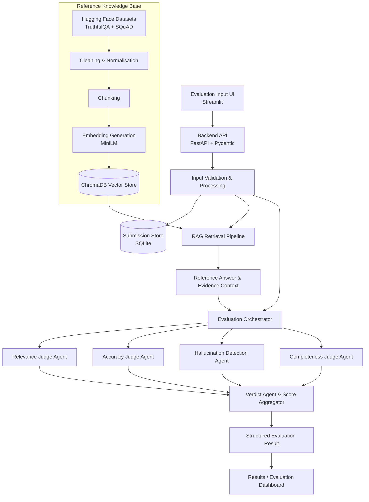

# System Architecture — Milestone 1

## High-level architecture

## End-to-end information flow

1. A user submits a question and AI-generated response, with an optional reference answer or source document.
2. The API validates required and optional fields and stores the submission.
3. The processing layer normalises text and prepares a retrieval query from the question and response context.
4. The RAG layer searches ChromaDB for candidate passages from the benchmark/reference knowledge base.
5. The orchestrator passes the submission and evidence to specialised judge agents.
6. Each judge returns a structured score, explanation, and evidence references.
7. The verdict component combines the judge outputs, applies guardrails, and produces a structured report.
8. The UI displays scores, explanations, detected unsupported claims, and the final verdict.

**Milestone 1 implementation boundary:** Steps 1–4 are being established. Steps 5–8 are architecture/design deliverables for subsequent implementation; do not describe them as completed until working code and tests exist.

## Component responsibilities

- **Evaluation Input UI:** captures the question, response, and optional references; outputs a request payload.
- **Backend/API Layer:** exposes endpoints and coordinates services; returns API responses.
- **Input Processing Module:** trims, normalises, and validates raw submissions; outputs structured submissions.
- **Submission Store:** persists the input and timestamp; returns a submission ID.
- **Dataset Ingestion Module:** loads benchmark examples and outputs standardised records.
- **Cleaning & Chunking:** removes empty/noisy text and splits long passages into chunks with metadata.
- **Embedding Module:** converts chunks and queries into embedding vectors.
- **Vector Database:** stores embeddings, text, and metadata in a searchable collection.
- **RAG Retrieval Pipeline:** retrieves ranked candidate evidence for a submitted question.
- **Evaluation Orchestrator:** manages judge execution and shared state.
- **Relevance Judge:** assesses whether the response answers the question.
- **Accuracy Judge:** compares answer claims with reference answers or known facts.
- **Hallucination Detection Agent:** identifies unsupported or contradicted claims and attaches evidence.
- **Completeness Judge:** checks whether important parts of the question are addressed.
- **Verdict Agent:** aggregates structured outputs and applies decision rules.
- **Results Module/UI:** presents an auditable evaluation report.

## Proposed data models

### EvaluationSubmission

- `submission_id`: UUID generated by the backend.
- `question`: required string.
- `ai_response`: required string.
- `reference_answer`: optional string.
- `source_document`: optional string for pasted reference content in the initial UI.
- `created_at`: UTC timestamp.

### RetrievedEvidence

- `chunk_id`: stable identifier for the indexed chunk.
- `text`: retrieved passage text.
- `dataset`: source dataset or document name.
- `record_id`: benchmark record identifier.
- `source`: URL or source label when available.
- `similarity_distance`: vector-store distance; smaller is closer for the configured distance metric.

### AgentEvaluation (planned)

- `agent_name`: name of the judge agent.
- `score`: numeric score from 1 to 5, where higher is better.
- `reasoning_summary`: concise explanation, not hidden chain-of-thought.
- `evidence_ids`: IDs of evidence chunks used.
- `flags`: list of issue labels such as `unsupported_claim`, `contradicted_claim`, or `missing_information`.

### EvaluationResult (planned)

- `submission_id`: associated submission.
- `dimension_scores`: relevance, accuracy, hallucination safety, and completeness.
- `overall_score`: weighted score from 1 to 5.
- `verdict`: `PASS`, `NEEDS_REVIEW`, or `FAIL`.
- `key_findings`: concise issues and strengths.
- `evidence`: citations/IDs for supporting passages.

## Agent orchestration proposal

The Orchestrator should execute the four judges using the same immutable submission and retrieved evidence package. Independent judges can run in parallel after evidence retrieval. The Verdict Agent should receive only structured judge outputs, not unstructured free-form conversation. It should preserve an `insufficient_evidence` state when references are absent or retrieval confidence is weak, rather than interpreting missing evidence as proof that a claim is false.

## Architecture decisions and open questions

- Keep the API, UI, ingestion code, retrieval code, and future judge agents in separate modules.
- Keep embeddings/vector data and raw datasets outside Git.
- Make the LLM provider configurable; do not hard-code a provider or API key before mentor/team agreement.
- Confirm with the mentor whether the first implementation should use a single LLM judge with structured criteria or separate model calls for each agent.
- Confirm whether source documents must be uploaded as files (PDF/DOCX) or whether pasted text is sufficient for the first input-module iteration.
