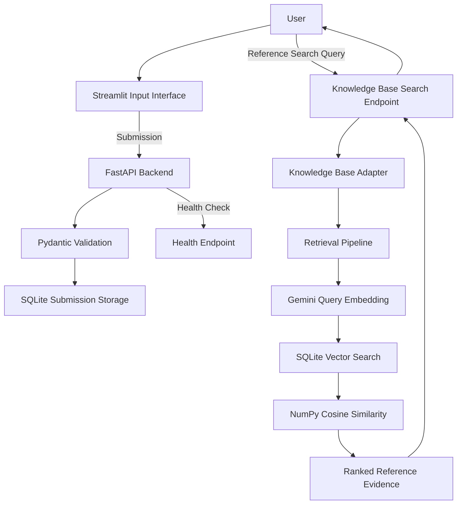
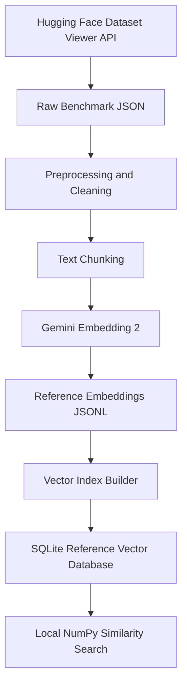

# System Architecture — AI Response Validation System

**Project:** Development of AI Response Validation System with Hallucination Detection Assistance
**Milestone:** 1 — Foundation and Evaluation Understanding
**Last updated:** 14 November 2026

**Architecture status:** Initial implementation established. Reference retrieval is partially populated. Automated evaluation and judge-agent orchestration are planned for subsequent milestones.

---

## 1. Architecture overview

The system is designed as a modular application that accepts an AI-generated response, stores the submission, retrieves relevant reference material, and eventually evaluates the response using structured evaluation criteria.

The architecture separates the following responsibilities:

1. User interaction and input collection.
2. Backend API and request validation.
3. Submission persistence.
4. Reference dataset acquisition and preprocessing.
5. Embedding generation and vector indexing.
6. Reference retrieval and evidence preparation.
7. Future automated evaluation and verdict generation.

The first six areas establish the foundation for the evaluation system. The final evaluation and verdict components are planned for subsequent development.

## 2. High-level architecture

### 2.1 Current implementation architecture

The following diagram represents the implemented input and retrieval components.

The current application has two primary workflows:

- **Submission workflow:** Collects, validates, and stores the question, AI-generated response, and optional reference material.
- **Reference retrieval workflow:** Converts a search query into an embedding, searches the local vector database, and returns ranked reference passages.

The workflows establish the foundation for a future integrated evaluation process. Automated judge-agent evaluation is not currently connected to either workflow.

### 2.2 Reference data ingestion architecture

Reference benchmark data is processed separately from query-time retrieval.

The ingestion workflow creates reference embeddings and stores them in a persistent SQLite database.

Query-time retrieval uses the existing stored embeddings rather than generating reference embeddings again.

## 3. Component responsibilities

### 3.1 User interface

**Technology:** Streamlit

Responsibilities:

- Collect the user's question.
- Collect the AI-generated response.
- Accept an optional reference answer.
- Accept optional pasted source/reference material.
- Submit the form to the backend API.
- Display submission status and API responses.

Current file:

`frontend/streamlit_app.py`

The current source-material input is a text field. PDF and DOCX upload and document parsing are not part of the current implementation.

### 3.2 Backend and API layer

**Technology:** FastAPI

Responsibilities:

- Expose HTTP API endpoints.
- Receive user submissions.
- Validate incoming request data.
- Store valid submissions.
- Provide reference knowledge-base search.
- Return structured API responses.

Current file:

`backend/app/main.py`

Implemented endpoints:

**GET `/health`**

Checks the backend service status.

**POST `/submissions`**

Accepts and validates a user submission, saves it in SQLite, and returns an HTTP 201 response.

**POST `/knowledge-base/search`**

Accepts a search query and a requested number of results. It retrieves candidate reference passages using the knowledge-base module.

FastAPI also provides interactive API documentation through `/docs`.

### 3.3 Input validation module

**Technology:** Pydantic

Current file:

`backend/app/schemas.py`

Responsibilities:

- Validate required question and response fields.
- Support optional reference answer and source material.
- Reject blank required inputs.
- Enforce configured length and input constraints.
- Validate knowledge-base search requests.

### 3.4 Submission storage

**Technology:** SQLite

Current file:

`backend/app/storage.py`

Responsibilities:

- Initialize the submission database.
- Store validated submissions.
- Generate submission identifiers.
- Store timestamps.
- Persist the submission payload.

Database file:

`data/submissions.db`

Submission storage is separate from the reference vector database.

### 3.5 Dataset ingestion and preprocessing

Responsibilities:

- Acquire public benchmark datasets.
- Store raw benchmark records.
- Clean and preprocess records.
- Preserve source information and dataset metadata.
- Generate standardised reference records.
- Prepare chunks for embedding generation.

Current benchmark datasets:

- TruthfulQA.
- SQuAD.

The current acquisition process uses the Hugging Face Dataset Viewer API and Python Requests.

### 3.6 Chunking module

Responsibilities:

- Divide processed reference text into manageable chunks.
- Apply a configured overlap between neighbouring chunks.
- Preserve chunk identifiers.
- Preserve dataset and source-record metadata.

Current configuration:

- Chunk size: 500 characters.
- Chunk overlap: 100 characters.

Output:

`data/processed/reference_chunks.json`

Current combined dataset contains 2,235 reference chunks.

### 3.7 Embedding module

**Technology:** Google Gemini Embedding 2

Responsibilities:

- Convert reference passages into numerical vectors.
- Convert search queries into numerical vectors.
- Validate embedding dimensions.
- Preserve the association between a vector and its reference chunk.
- Support resumable reference embedding generation.

Expected embedding dimension:

`3072`

Important distinction:

- Reference embeddings are generated during ingestion.
- Query embeddings are generated when a search request is made.

API credentials are loaded through environment configuration and should never be committed to version control.

### 3.8 Vector storage and indexing

**Technology:** SQLite

Current database:

`data/processed/reference_vectors.db`

Responsibilities:

- Store reference chunk identifiers.
- Store embedding vectors.
- Store vector norms.
- Store dataset and record metadata.
- Support local vector retrieval.

The current implementation uses SQLite rather than ChromaDB as its active vector database.

### 3.9 Similarity search module

**Technology:** NumPy

Current module:

`backend/retrieval/vector_search.py`

Responsibilities:

- Load vectors from SQLite.
- Validate the query vector.
- Calculate cosine similarity.
- Rank reference vectors.
- Return the top-k results.
- Apply optional dataset filtering.
- Preserve reference text and metadata.

The current implementation performs local cosine similarity search over the stored vectors.

### 3.10 Retrieval orchestration

Current modules:

- `backend/retrieval/query_embedder.py`
- `backend/retrieval/retriever.py`
- `backend/retrieval/vector_search.py`
- `backend/retrieval/context_builder.py`
- `backend/app/knowledge_base.py`

Responsibilities:

1. Validate a natural-language query.
2. Generate the query embedding.
3. Search the local SQLite vector database.
4. Rank matching reference chunks.
5. Prepare evidence records.
6. Return the retrieved passages through the FastAPI endpoint.

The context builder also prepares labelled evidence records for subsequent evaluation components.

### 3.11 Evaluation components — planned

The following components are part of the proposed architecture, not the current implementation.

**Evaluation Orchestrator**

- Coordinates the future evaluation workflow.
- Collects the submission and reference evidence.
- Invokes the evaluation agents.
- Tracks evaluation status.

**Relevance Judge**

- Checks whether the AI-generated response addresses the original question.

**Accuracy Judge**

- Compares factual claims against reference material.

**Hallucination Detection Agent**

- Identifies unsupported and contradicted claims.
- Associates findings with reference evidence.

**Completeness Judge**

- Identifies missing or insufficiently addressed information.

**Verdict Agent**

- Aggregates structured evaluation results.
- Applies agreed decision thresholds.
- Produces a final assessment.

These components will be implemented in later milestones after the input, retrieval, and evaluation interfaces are agreed upon.

## 4. Data flow

### 4.1 User submission workflow

1. The user opens the Streamlit application.
2. The user enters a question and AI-generated response.
3. The user may provide an optional reference answer or pasted reference material.
4. Streamlit sends the submission to the FastAPI backend.
5. Pydantic validates the incoming data.
6. The storage module saves the validated submission.
7. The API returns a submission identifier and acceptance status.
8. The application displays the response.

No automated evaluation score is calculated in this workflow.

### 4.2 Reference ingestion workflow

1. The acquisition scripts obtain benchmark records.
2. Raw records are saved under `data/raw/`.
3. Preprocessing scripts clean and standardise the records.
4. Processed records are saved under `data/processed/`.
5. The chunking process creates overlapping reference passages.
6. The embedding script generates vector representations using Gemini Embedding 2.
7. Embeddings are stored in JSONL format.
8. The vector index builder inserts the embeddings and metadata into SQLite.

### 4.3 Reference retrieval workflow

1. A search request is received through the knowledge-base search endpoint.
2. The knowledge-base adapter calls the retrieval pipeline.
3. The query is validated.
4. Gemini Embedding 2 generates a query vector.
5. The vector-search module loads the stored reference embeddings.
6. NumPy calculates cosine similarity.
7. Results are sorted by similarity.
8. The requested top-k reference passages are returned.
9. The knowledge-base adapter preserves the passage text, metadata, rank, similarity score, and distance.
10. FastAPI returns the search results.

**Important:** Generating a query embedding requires an external Gemini API request. The local NumPy search itself does not require an external API call.

## 5. Proposed data models

### 5.1 EvaluationSubmission

The submission model represents the data received from the user.

Fields:

- `question`: required question string.
- `ai_response`: required AI-generated response.
- `reference_answer`: optional reference answer.
- `source_document`: optional pasted reference material.

The storage layer adds the submission identifier and timestamp when the submission is saved.

### 5.2 KnowledgeSearchRequest

Represents a reference search request.

Fields:

- `query`: natural-language search query.
- `top_k`: number of ranked results requested, subject to validation constraints.

### 5.3 RetrievedEvidence

Represents a retrieved reference passage.

The current retrieval response contains:

- `text`: retrieved reference passage.
- `metadata`: original reference metadata.
- `metadata.chunk_id`: unique reference chunk identifier.
- `metadata.dataset`: source dataset name.
- `metadata.record_id`: original dataset record identifier.
- `metadata.chunk_index`: index of the reference chunk.
- `rank`: position in the ranked retrieval results.
- `similarity_score`: cosine similarity score.
- `distance`: distance represented as one minus the similarity score.

The original source metadata is retained inside the metadata dictionary.

### 5.4 AgentEvaluation — planned

Proposed fields:

- `agent_name`: identifier of the evaluating agent.
- `score`: numerical score between 1 and 5.
- `reasoning_summary`: concise explanation of the score.
- `evidence_ids`: identifiers of evidence passages used.
- `flags`: list of evaluation issue labels.

This model is a future design proposal.

### 5.5 EvaluationResult — planned

Proposed fields:

- `submission_id`: associated submission.
- `dimension_scores`: relevance, accuracy, hallucination safety, and completeness.
- `overall_score`: weighted evaluation score.
- `verdict`: PASS, NEEDS_REVIEW, or FAIL.
- `key_findings`: summary of issues and strengths.
- `evidence`: supporting evidence identifiers and references.

This model is not currently implemented.

## 6. Proposed evaluation scoring

The planned scoring model contains four dimensions:

| Evaluation dimension | Proposed weight |
|---|---:|
| Relevance | 20% |
| Accuracy | 30% |
| Hallucination safety | 30% |
| Completeness | 20% |

Each dimension uses a proposed score from 1 to 5.

The detailed rubric is maintained separately in:

`docs/SCORING_RUBRIC.md`

The weights and thresholds require mentor approval and calibration against human-reviewed examples before implementation.

## 7. Testing and verification architecture

### 7.1 Formal automated tests

The current pytest suite is located under:

`tests/`

Current formal test file:

`tests/test_schemas.py`

The three formal tests cover:

1. Optional reference fields in valid submissions.
2. Rejection of blank required fields.
3. Validation of the bounded top-k search parameter.

The latest full pytest run reported three passing tests.

### 7.2 Standalone retrieval tests

Additional verification scripts are located under:

`backend/scripts/`

They cover:

- SQLite vector search.
- Offline reference retrieval.
- Mock retrieval pipeline integration.
- Context generation.
- Evidence identifiers.
- Metadata preservation.
- Similarity threshold filtering.
- Context length constraints.

### 7.3 Verification boundary

Local tests using stored or mocked vectors establish that the retrieval mechanics and integration logic work.

They do not independently establish semantic retrieval quality for unseen questions.

Fresh query embedding and independent relevance inspection are still required.

## 8. Current implementation status

### Implemented

- Streamlit input interface.
- FastAPI backend.
- Pydantic request validation.
- SQLite submission storage.
- API health endpoint.
- Submission endpoint.
- Knowledge-base search endpoint.
- TruthfulQA data acquisition and preprocessing.
- SQuAD pilot data acquisition and preprocessing.
- Reference chunking.
- Gemini Embedding 2 integration.
- Partial reference embedding generation.
- SQLite vector database.
- NumPy cosine similarity search.
- Retrieval pipeline.
- Evidence context builder.
- Local automated and integration checks.

### Pending

- Remaining TruthfulQA embeddings.
- SQuAD reference embeddings.
- Full vector index population.
- Fresh query embedding and semantic retrieval evaluation.
- Manual relevance inspection across both datasets.
- Final retrieval quality documentation.

### Planned for subsequent milestones

- Claim extraction.
- Judge-agent interfaces.
- Automated factuality evaluation.
- Hallucination classification.
- Score aggregation.
- Verdict generation.
- Evaluation report presentation.

## 9. Architecture decisions and open questions

### Current decisions

1. Keep the frontend, backend, ingestion, retrieval, and future evaluation components in separate modules.
2. Use SQLite for submission persistence.
3. Use SQLite for local reference vector storage.
4. Use NumPy for cosine similarity calculations.
5. Use Gemini Embedding 2 for reference and query embeddings.
6. Retain benchmark datasets and generated embeddings outside version control.
7. Store API credentials in environment variables rather than source files.
8. Keep automated judging separate from the current Milestone 1 input and retrieval modules.

### Legacy implementation note

An earlier ingestion script used ChromaDB. The active retrieval implementation has been migrated to SQLite and NumPy.

The older ChromaDB-oriented ingestion script remains in the repository as legacy code and is not part of the current active retrieval workflow.

### Open questions for mentor review

- Should the final evaluation use a single LLM judge with structured criteria or separate model calls for different evaluation dimensions?
- Which LLM provider and model should be selected for evaluation?
- Should future reference documents support PDF and DOCX uploads, or is pasted text sufficient for the first version?
- Which evaluation thresholds and verdict rules should be approved?
- Which retrieval metrics should be used to measure independent semantic retrieval quality?

---

**Architecture completion note:** The current architecture provides a working foundation for user input, submission persistence, benchmark ingestion, and partially populated reference retrieval. Automated judge agents, scoring, orchestration, and verdict generation remain planned components for subsequent milestones.
