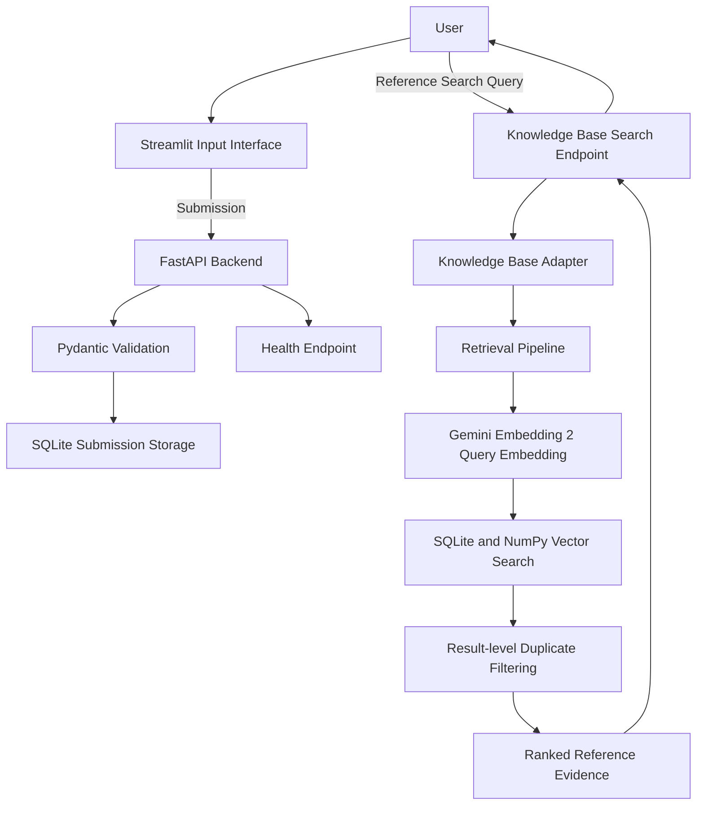
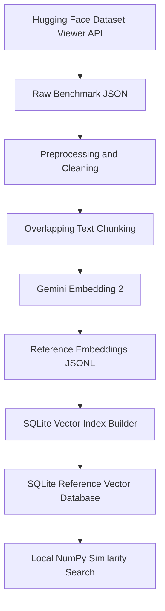
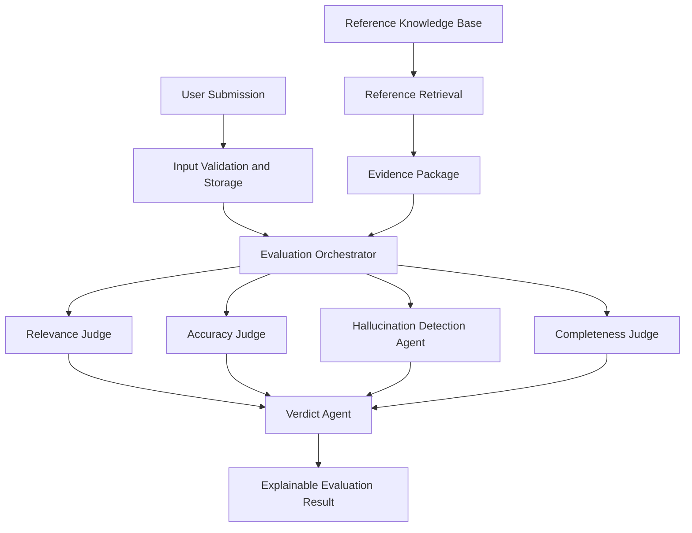

# System Architecture — AI Response Validation System

**Project:** Development of AI Response Validation System with Hallucination Detection Assistance  
**Milestone:** 1 — Foundation and Evaluation Understanding  
**Last updated:** 16 November 2026  
**Architecture status:** The input and storage foundation and initial reference retrieval workflow are implemented. Initial live retrieval examples have been tested against TruthfulQA and SQuAD. Automated response evaluation, judge-agent orchestration, scoring, and verdict generation remain planned for subsequent milestones.

---

## 1. Architecture overview

The system is designed as a modular application that accepts an AI-generated response, stores the submission, retrieves relevant reference material, and eventually evaluates the response using structured evaluation criteria.

The architecture separates the following responsibilities:

1. User interaction and input collection.
2. Backend API and request validation.
3. Submission persistence.
4. Reference dataset acquisition and preprocessing.
5. Embedding generation and vector indexing.
6. Reference retrieval and evidence preparation.
7. Future automated evaluation and verdict generation.

The current Milestone 1 implementation provides the input and storage foundation and the reference retrieval workflow. The future evaluation and verdict components are designed but not yet implemented.

## 2. High-level architecture

### 2.1 Current submission and retrieval architecture

The application currently has two primary workflows: submission storage and reference search.

**Submission workflow:** Collects, validates, and stores the question, AI-generated response, and optional reference material.

**Reference retrieval workflow:** Converts a search query into an embedding, searches the local vector database, filters repeated passage text from the result list, and returns ranked reference passages.

The two workflows establish the foundation for a future integrated evaluation process. Automated judge-agent evaluation is not currently connected to either workflow.

### 2.2 Reference data ingestion architecture

Reference benchmark data is processed separately from query-time retrieval.

The ingestion workflow creates reference embeddings and stores them in a persistent SQLite database. Query-time retrieval uses the stored reference embeddings rather than generating reference embeddings again.

### 2.3 Proposed future evaluation architecture

The following diagram describes the intended evaluation flow. The judge agents and final verdict components are proposed architecture components and are not part of the current implemented runtime.

This proposed architecture will be implemented incrementally after the input, retrieval, evaluation interfaces, and rubric are reviewed.

---

## 3. Component responsibilities

### 3.1 User interface

**Technology:** Streamlit  
**Current file:** `frontend/streamlit_app.py`

Responsibilities:

- Collect the user's question.
- Collect the AI-generated response.
- Accept an optional reference answer.
- Accept optional pasted source/reference material.
- Submit the form to the backend API.
- Display submission status and API responses.

The current source-material input is a text field. PDF/DOCX upload and document parsing are not part of the current implementation.

### 3.2 Backend and API layer

**Technology:** FastAPI  
**Current file:** `backend/app/main.py`

Responsibilities:

- Expose HTTP API endpoints.
- Receive user submissions.
- Validate incoming request data.
- Store valid submissions.
- Provide reference knowledge-base search.
- Return structured API responses.

Implemented endpoints:

**GET `/health`**  
Checks the backend service status.

**POST `/submissions`**  
Accepts and validates a user submission, saves it in SQLite, and returns an HTTP 201 response after successful storage.

**POST `/knowledge-base/search`**  
Accepts a search query and a requested number of results. It retrieves candidate reference passages using the knowledge-base module.

FastAPI also provides interactive API documentation through `/docs`.

### 3.3 Input validation module

**Technology:** Pydantic  
**Current file:** `backend/app/schemas.py`

Responsibilities:

- Validate required question and response fields.
- Support optional reference answer and source material.
- Reject blank required inputs.
- Enforce configured length and input constraints.
- Validate knowledge-base search requests.

### 3.4 Submission storage

**Technology:** SQLite  
**Current file:** `backend/app/storage.py`  
**Database file:** `data/submissions.db`

Responsibilities:

- Initialize the submission database.
- Store validated submissions.
- Generate submission identifiers.
- Store timestamps.
- Persist the submission payload.

Submission storage is separate from the reference vector database.

### 3.5 Dataset ingestion and preprocessing

Responsibilities:

- Acquire public benchmark datasets.
- Store raw benchmark records.
- Clean and preprocess records.
- Preserve source information and dataset metadata.
- Generate standardised reference records.
- Prepare chunks for embedding generation.

Current benchmark datasets:

- TruthfulQA.
- SQuAD.

The current acquisition process uses the Hugging Face Dataset Viewer API and Python Requests.

### 3.6 Chunking module

**Current file:** `backend/scripts/chunk_reference_data.py`  
**Output:** `data/processed/reference_chunks.json`

Responsibilities:

- Divide processed reference text into manageable chunks.
- Apply configured overlap between neighbouring chunks.
- Preserve chunk identifiers.
- Preserve dataset and source-record metadata.
- Preserve SQuAD question, answer, and answer-offset metadata.

Current configuration:

- Chunk size: 500 characters.
- Chunk overlap: 100 characters.

The combined processed dataset contains 2,235 chunks: 892 TruthfulQA chunks and 1,343 SQuAD chunks.

**Known limitation:** Separate SQuAD question records can share the same source context. The current chunking script processes each record independently, so the same context can produce repeated chunks with different chunk IDs. Source-level context deduplication is a future improvement.

### 3.7 Embedding module

**Technology:** Google Gemini Embedding 2  
**Current reference generator:** `backend/scripts/generate_embeddings.py`  
**Current query embedder:** `backend/retrieval/query_embedder.py`

Responsibilities:

- Convert reference passages into numerical vectors.
- Convert search queries into numerical vectors.
- Validate embedding dimensions and numerical values.
- Preserve the association between a vector and its reference chunk.
- Support resumable reference embedding generation.

Expected embedding dimension:

`3072`

The reference-document formatter currently uses:

`title: {title} | text: {text}`

The query embedder prepares question-answering queries using:

`task: question answering | query: {question}`

Important distinction:

- Reference embeddings are generated during ingestion.
- Query embeddings are generated when a search request is made.

A query embedding requires an external Gemini API request. API credentials are loaded through local environment configuration and must never be committed to version control.

### 3.8 Vector storage and indexing

**Technology:** SQLite  
**Current builder:** `backend/scripts/build_vector_index.py`  
**Current database:** `data/processed/reference_vectors.db`

Responsibilities:

- Store reference chunk identifiers.
- Store embedding vectors.
- Store vector norms.
- Store dataset and record metadata.
- Support local vector retrieval.

The current database contains 2,235 chunk-ID records:

- TruthfulQA: 892.
- SQuAD: 1,343.

The active vector implementation uses SQLite rather than ChromaDB.

**Known limitation:** The SQLite database retains the repeated SQuAD records. Result-level duplicate filtering does not remove those underlying rows.

### 3.9 Similarity search module

**Technology:** NumPy  
**Current module:** `backend/retrieval/vector_search.py`

Responsibilities:

- Load vectors from SQLite.
- Validate the query vector.
- Calculate cosine similarity.
- Rank reference vectors.
- Apply optional dataset filtering.
- Filter repeated normalized passage text in returned results.
- Preserve reference text and metadata.
- Return ranked passages with similarity scores.

The current result-level deduplication key uses dataset, normalized title, and normalized text. The highest-scoring occurrence is retained in the returned result list. Associated record IDs, questions, and reference answers are collected into the result's matched metadata fields.

This correction improves the result list but does not rebuild the source chunks or remove duplicate records from the database.

### 3.10 Retrieval orchestration

Current modules:

- `backend/retrieval/query_embedder.py`
- `backend/retrieval/retriever.py`
- `backend/retrieval/vector_search.py`
- `backend/retrieval/context_builder.py`
- `backend/app/knowledge_base.py`

Responsibilities:

1. Validate a natural-language query.
2. Generate the query embedding through Gemini Embedding 2.
3. Search the local SQLite vector database.
4. Calculate and rank similarity scores.
5. Filter repeated text from returned results.
6. Prepare evidence records and context.
7. Return the retrieved passages through the FastAPI endpoint.

The context builder prepares labelled evidence records for subsequent evaluation components.

### 3.11 Evaluation components — planned

The following components are part of the proposed architecture, not the current implementation.

**Evaluation Orchestrator**

- Coordinates the future evaluation workflow.
- Collects the submission and reference evidence.
- Invokes the evaluation agents.
- Tracks evaluation status.

**Relevance Judge**

- Checks whether the AI-generated response addresses the original question.

**Accuracy Judge**

- Compares factual claims against reference material.

**Hallucination Detection Agent**

- Identifies unsupported and contradicted claims.
- Associates findings with reference evidence.

**Completeness Judge**

- Identifies missing or insufficiently addressed information.

**Verdict Agent**

- Aggregates structured evaluation results.
- Applies approved decision thresholds.
- Produces a final assessment.

These components will be implemented in later milestones after the input, retrieval, and evaluation interfaces are agreed upon.

---

## 4. Data flow

### 4.1 User submission workflow

1. The user opens the Streamlit application.
2. The user enters a question and AI-generated response.
3. The user may provide an optional reference answer or pasted reference material.
4. Streamlit sends the submission to the FastAPI backend.
5. Pydantic validates the incoming data.
6. The storage module saves the validated submission.
7. The API returns a submission identifier and acceptance status.
8. The application displays the response.

No automated evaluation score is calculated in this workflow.

### 4.2 Reference ingestion workflow

1. Acquisition scripts obtain benchmark records.
2. Raw records are saved under `data/raw/`.
3. Preprocessing scripts clean and standardise the records.
4. Processed records are saved under `data/processed/`.
5. The chunking process creates overlapping reference passages.
6. The embedding script generates vector representations using Gemini Embedding 2.
7. Embeddings are stored in JSONL format.
8. The vector index builder inserts embeddings and metadata into SQLite.

### 4.3 Reference retrieval workflow

1. A search request is received through the knowledge-base search endpoint.
2. The knowledge-base adapter calls the retrieval pipeline.
3. The query is validated.
4. Gemini Embedding 2 generates a query vector.
5. The vector-search module loads stored reference embeddings.
6. NumPy calculates cosine similarity.
7. Candidate results are sorted by similarity.
8. Result-level duplicate filtering retains distinct normalized passages.
9. The requested top-k reference passages are returned.
10. The knowledge-base adapter preserves passage text, metadata, rank, similarity score, and distance.
11. FastAPI returns the search results.

**Important:** Generating a query embedding requires an external Gemini API request. Local SQLite loading, NumPy similarity calculations, result deduplication, and context formatting do not require an external API request.

---

## 5. Proposed data models

### 5.1 EvaluationSubmission

The submission model represents the data received from the user.

Fields:

- `question`: required question string.
- `ai_response`: required AI-generated response.
- `reference_answer`: optional reference answer.
- `source_document`: optional pasted reference material.

The storage layer adds the submission identifier and timestamp when the submission is saved.

### 5.2 KnowledgeSearchRequest

Represents a reference search request.

Fields:

- `query`: natural-language search query.
- `top_k`: number of ranked results requested, subject to validation constraints.

### 5.3 RetrievedEvidence

Represents a retrieved reference passage.

The current retrieval response contains:

- `text`: retrieved reference passage.
- `metadata`: original reference metadata.
- `metadata.chunk_id`: reference chunk identifier.
- `metadata.dataset`: source dataset name.
- `metadata.record_id`: original dataset record identifier.
- `metadata.chunk_index`: index of the reference chunk.
- `rank`: position in the ranked retrieval results.
- `similarity_score`: cosine similarity score.
- `distance`: distance represented as one minus the similarity score.
- `matched_record_ids`: source record IDs associated with the retained passage.
- `matched_questions`: questions associated with the retained passage.
- `matched_reference_answers`: reference answers associated with the retained passage.

The original source metadata is retained inside the metadata dictionary. The matched fields are populated when repeated passage content is grouped by the result-level deduplication logic.

### 5.4 AgentEvaluation — planned

Proposed fields:

- `agent_name`: identifier of the evaluating agent.
- `score`: numerical score between 1 and 5.
- `reasoning_summary`: concise explanation of the score.
- `evidence_ids`: identifiers of evidence passages used.
- `flags`: list of evaluation issue labels.

This model is a future design proposal.

### 5.5 EvaluationResult — planned

Proposed fields:

- `submission_id`: associated submission.
- `dimension_scores`: relevance, accuracy, hallucination safety, and completeness.
- `overall_score`: weighted evaluation score.
- `verdict`: PASS, NEEDS_REVIEW, or FAIL.
- `key_findings`: summary of issues and strengths.
- `evidence`: supporting evidence identifiers and references.

This model is not currently implemented.

---

## 6. Proposed evaluation scoring

The planned scoring model contains four dimensions:

| Evaluation dimension | Proposed weight |
|---|---:|
| Relevance | 20% |
| Accuracy | 30% |
| Hallucination safety | 30% |
| Completeness | 20% |

Each dimension uses a proposed score from 1 to 5.

The weights and thresholds require mentor approval and calibration against human-reviewed examples before implementation.

Detailed definitions and provisional thresholds are maintained in `docs/SCORING_RUBRIC.md`.

---

## 7. Testing and verification architecture

### 7.1 Formal automated tests

The current pytest suite is located under `tests/`.

Current formal test file:

`tests/test_schemas.py`

The three formal tests cover:

1. Optional reference fields in valid submissions.
2. Rejection of blank required fields.
3. Validation of the bounded top-k search parameter.

A previous full pytest run reported three passing tests. Re-run the suite before final submission to confirm the current repository state.

### 7.2 Standalone retrieval tests

Additional verification scripts are located under `backend/scripts/`.

They cover:

- SQLite vector search.
- Offline reference retrieval.
- Mock retrieval pipeline integration.
- Context generation.
- Evidence identifiers.
- Metadata preservation.
- Similarity threshold filtering.
- Context length constraints.

The context builder script reported seven passing checks. The retriever mock script reported four passing checks. The offline retrieval script reported three passing checks.

### 7.3 Live semantic retrieval examples

Two initial live retrieval examples were manually inspected.

**TruthfulQA**

- Query: “What happens to watermelon seeds after a person eats them?”
- Matching reference retrieved at Rank 1.
- Similarity score: `0.828731`.

**SQuAD**

- Query: “What is located immediately behind the Basilica of the Sacred Heart?”
- Relevant Grotto passage retrieved at Rank 2.
- Similarity score: `0.690037`.

The results show that the live query embedding and local search path can retrieve relevant reference passages for these examples. They do not establish general retrieval precision or recall.

### 7.4 Verification boundary

Local tests using stored or mocked vectors establish that the retrieval mechanics and integration logic work. Fresh query embedding and manual relevance inspection provide additional functional evidence.

A larger labelled evaluation set is still required to measure retrieval quality more systematically.

---

## 8. Current implementation status

### Implemented

- Streamlit input interface.
- FastAPI backend.
- Pydantic request validation.
- SQLite submission storage.
- API health endpoint.
- Submission endpoint.
- Knowledge-base search endpoint.
- TruthfulQA data acquisition and preprocessing.
- SQuAD pilot acquisition and preprocessing.
- Reference chunking.
- Gemini Embedding 2 document embedding generation.
- Gemini Embedding 2 query embedding integration.
- 2,235 reference embeddings generated.
- SQLite vector database containing 2,235 records.
- NumPy cosine similarity search.
- Dataset filtering.
- Retrieval-result duplicate filtering.
- Retrieval pipeline.
- Evidence context builder.
- Local automated and integration checks.
- Two initial live semantic retrieval examples.

### Pending or future improvements

- Broader labelled semantic retrieval evaluation.
- Source-level SQuAD context deduplication.
- Additional formal tests for deduplication and metadata aggregation.
- Claim extraction.
- Judge-agent interfaces.
- Automated factuality evaluation.
- Hallucination classification.
- Score aggregation.
- Verdict generation.
- Evaluation report presentation.

---

## 9. Architecture decisions and open questions

### Current decisions

1. Keep the frontend, backend, ingestion, retrieval, and future evaluation components in separate modules.
2. Use SQLite for submission persistence.
3. Use SQLite for local reference vector storage.
4. Use NumPy for cosine similarity calculations.
5. Use Gemini Embedding 2 for reference and query embeddings.
6. Retain benchmark datasets and generated embeddings outside version control.
7. Store API credentials in environment variables rather than source files.
8. Keep automated judging separate from the current Milestone 1 input and retrieval modules.
9. Filter repeated normalized passage text in retrieval results while retaining associated question and answer metadata.

### Legacy implementation note

An earlier ingestion script used ChromaDB. The active retrieval implementation uses SQLite and NumPy. The older ChromaDB-oriented ingestion script remains in the repository as legacy code and is not part of the active retrieval workflow.

### Open questions for mentor review

- Should the final evaluation use a single LLM judge with structured criteria or separate model calls for different evaluation dimensions?
- Which LLM provider and model should be selected for evaluation?
- Should future reference documents support PDF and DOCX uploads, or is pasted text sufficient for the first version?
- Which evaluation thresholds and verdict rules should be approved?
- Which retrieval metrics should be used to measure independent semantic retrieval quality?
- Should SQuAD source contexts be deduplicated during ingestion, with all associated questions and answer spans preserved?

---

## 10. Architecture completion note

The current architecture provides an implemented foundation for user input, submission persistence, benchmark ingestion, embedding generation, vector indexing, semantic retrieval, and evidence-context construction. Initial live retrieval examples have been tested against both benchmark datasets.

Automated judge agents, scoring orchestration, and verdict generation remain planned components for subsequent milestones. The architecture and scoring rubric require mentor review and approval.
